# MPU (Memory Protection Unit) and Cache Management on Cortex-M7

## Contents

1. [MPU (Memory Protection Unit)](#mpu-memory-protection-unit)
2. [Memory Types & Attributes](#memory-types--attributes)
3. [Cache Policies](#cache-policies)
4. [Cache Coherency Problems and Maintenance Operations](#cache-coherency-problems-and-maintenance-operations)
5. [Quick Reference](#quick-reference)

---

# MPU (Memory Protection Unit)

## What is MPU?

The MPU is a block of hardware inside the processor. It sits on the path between the CPU and the bus, and every transaction passes through it: data reads, data writes, and instruction fetches.

For each transaction the MPU looks up which **region** the address belongs to, then checks two things:

- Is this access allowed (privileged or unprivileged, read or write)?
- What **attributes** does this memory have (cacheable, bufferable, shareable, executable)?

In short:

* The MPU prevents code from touching memory it was never given.
* It allows privileged access to defined regions only.
* Everything is controlled by region attributes.
* It watches every transaction, including instruction fetches.
* A violation raises a fault exception (MemManage fault, or HardFault if MemManage is not enabled).

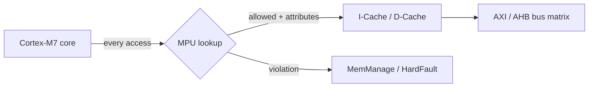

Two things make the MPU different from what many people expect:

1. **It does more than protect.** On Cortex-M7 the MPU is also the only place where you set the memory attributes (cacheable, bufferable, shareable, XN). Cache behaviour is driven by those attributes.
2. **It works even when you are not running an RTOS.** Even a bare-metal project benefits, for the reasons in the next section.

## Why use MPU

Three reasons, in the order we will cover them:

* Speculative access
* DMA issues
* Task management

### Speculative Access

A modern core does not wait to be told what it needs. To keep the pipeline full it guesses, and it starts memory accesses in advance. These are **speculative accesses**: the bus sees a real transaction even though the program may never use the result.

What does it access? Anything the core thinks it might need soon: the bytes after the current instruction, the target of a predicted branch, the neighbours of a recently used data word.

There are three types:

* Speculative read
* Speculative instruction fetch
* Speculative cache linefill

#### Speculative READ

A speculative read is a read from a **Normal** memory region that the core issues in advance.

* The MCU might never need that data.
* It improves performance when the guess is right.
* Sometimes the address is invalid, for example past the end of a populated external memory.
* That can cause a bus error or even stall the system.
* External memories (SDRAM, NOR, NAND-like interfaces) are the classic victims.
* The MPU can be set up to forbid it, by marking the region Device or Strongly-ordered (see the next chapter).

#### Speculative Instruction Fetch

The core fetches instructions ahead of the program counter, whether or not they will execute.

* Some fetched instructions will never run (a branch goes elsewhere).
* Some fetched words are not even valid instructions (data, or an unmapped address).
* It improves performance.
* The fix is to mark non-code memory as **XN** (Execute Never), covered below.

#### Speculative cache linefills

Because the cache works in 32-byte lines, one speculative access can pull in a whole line.

* It only happens in **cacheable** regions.
* It can happen with no load or store instruction at all, driven only by prefetching.
* That is how stale data ends up in the cache without your code ever touching it. Keep this in mind for the DMA chapter.

## DMA Issues

DMA and the data cache do not get along by default. The CPU goes through the D-cache, but the DMA goes straight to memory. The Cortex-M7 data cache has no hardware snooping, so nobody tells the cache when DMA changes memory.

* DMA and cacheable regions do not work together without help.
* Data **coherency** has to be restored.
* It can be done in software (clean and invalidate operations).
* Making the DMA buffer region non-cacheable also works.
* Details follow in the cache policies and coherency chapters.

## Task Management

When you run an RTOS, the MPU gives each task its own view of memory.

* Tasks can be restricted to specific regions.
* They can be blocked from touching system resources (peripheral registers, kernel data, another task's stack).
* A runaway task faults instead of silently corrupting everything.

---

# Memory Types & Attributes

## Memory Types in Cortex-M7

1. Normal Memory
2. Device Memory
3. Strongly Ordered Memory

### Normal memory

The processor can re-order transactions for efficiency, and it can perform speculative reads.

### Device & Strongly Ordered

The processor preserves transaction order relative to other transactions to Device or Strongly-ordered memory.

Practical consequences:

* Normal memory is good for code execution and for ordinary RAM.
* It allows speculative access.
* There is **no speculative access** in Strongly-ordered or Device memory.
* For Strongly-ordered memory the CPU waits for each access to finish before the next one proceeds.
* Every write must be visible to the target device when it happens (think of an external NAND controller where the order of command and data writes matters).
* Device memory is what microcontroller peripheral registers need.

### Memory access behavior (key table)

**[Arm]** Derived from the ARMv7-M architecture rules. This table is not in DS90003195A.

| Property | Normal | Device | Strongly-ordered |
|---|---|---|---|
| Access reordering vs. other accesses | Allowed | Not reordered relative to other Device / Strongly-ordered accesses | Never reordered |
| Speculative data reads | Allowed | Not allowed | Not allowed |
| Write buffering (CPU continues before write completes) | Yes (if bufferable) | Yes, if the Device region is bufferable | No, the write must complete first |
| Cacheable | Yes (per C/B/TEX bits) | No | No |
| Merging / repeating of accesses | May be merged | Not merged | Not merged |
| Unaligned access | Allowed (not for LDM/STM/LDRD/STRD) | Faults | Faults |
| Typical use | Code, RAM, buffers | Peripheral registers, external devices | Registers where completion must be guaranteed |

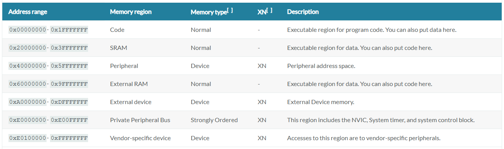


## Attributes

Every MPU region carries four attributes:

* Shareability
* Cacheability
* Bufferability
* Executable Never (XN)

### Shareable Region

A shareable region is memory that **more than one master** can access. The classic example is a RAM region used by both the CPU and a DMA controller.

* Strongly-ordered memory is always shareable.
* On Cortex-M7, if a normal region is marked cacheable **and** shareable, the data cache cannot be used for it. The accesses go straight to memory. 
* The instruction cache can still be used for shareable regions.

Why it matters: "shareable" is the processor's way of saying "someone else may change this memory behind your back". Since the M7 has no cache coherency hardware, the safe answer is to bypass the D-cache.

#### Example for Shareable Region

**Ethernet DMA descriptors for Tx and Rx.** The Ethernet MAC reads and writes the descriptor rings while the CPU also reads and writes them (the CPU gives a descriptor to the MAC, the MAC hands it back). Both masters poll shared ownership bits.

* Typical size: a 256-byte region covering the Tx and Rx descriptors (ST's Ethernet examples use a 256-byte region.).
* Attributes: shareable, not cacheable, bufferable (Device-like).
* Without this, the CPU keeps reading the ownership bit from its D-cache and never sees the MAC's update.

### Cacheable Region

A cacheable region is where the cache is allowed to hold copies, i.e. instruction cache and data cache.

* Cacheable is good for speed.
* It must be **disabled** (or managed in software) when two masters synchronise through the same memory.
* Cache policies (write-through, write-back, allocate) are covered in the next chapter.

#### Example for Disabling Cache

Take a buffer that a DMA fills and the CPU then reads. There are three ways to keep the CPU from reading stale cache lines. Disabling cache for the region is the simplest.

**Option A: make the buffer region non-cacheable with the MPU (recommended for DMA buffers).**

```c
/* STM32F769-specific: SRAM2 base and size must be checked in RM0410 memory map */
MPU_Region_InitTypeDef r = {0};

HAL_MPU_Disable();

r.Enable           = MPU_REGION_ENABLE;
r.Number           = MPU_REGION_NUMBER3;
r.BaseAddress      = 0x2007C000;            /* verify: start of SRAM2 */
r.Size             = MPU_REGION_SIZE_16KB;  /* base must be a multiple of 16 KB */
r.AccessPermission = MPU_REGION_FULL_ACCESS;
r.TypeExtField     = MPU_TEX_LEVEL1;        /* TEX=001, C=0, B=0 : Normal, non-cacheable */
r.IsCacheable      = MPU_ACCESS_NOT_CACHEABLE;
r.IsBufferable     = MPU_ACCESS_NOT_BUFFERABLE;
r.IsShareable      = MPU_ACCESS_NOT_SHAREABLE;
r.DisableExec      = MPU_INSTRUCTION_ACCESS_ENABLE;
r.SubRegionDisable = 0x00;
HAL_MPU_ConfigRegion(&r);

HAL_MPU_Enable(MPU_PRIVILEGED_DEFAULT);
```

Then put DMA buffers in that region with a linker section or a section attribute.

**Option B: disable the whole D-cache** (`SCB_DisableDCache()`). It works, and it is a good debugging step ("does the bug disappear with cache off?"), but it throws away most of the M7's speed.

**Option C: keep the region cacheable and use clean/invalidate** (see the coherency chapter).

Trade-off: Option A costs speed on every CPU access to the buffer, but needs no maintenance calls and cannot be forgotten. The app note (Section 5) lists the same trade-off: it is transparent to the application and easy when porting a driver from an MCU without cache, but needs an MPU region and a more complex linker script. Its example region is a 4 KB non-cacheable slice at the end of SRAM, with the rest of SRAM left WB-RWA, and DMA buffers placed in it with `__attribute__ ((section (".ram_nocache"), aligned (32)))`. The app note's GMAC receive-descriptor ownership bit is the same kind of case as the Ethernet descriptors above. Its code ends with `__DSB()` and `__ISB()` after enabling the MPU, which is a good habit to copy.

### Bufferable Region

Bufferable means the CPU may continue executing before a write has actually reached memory. The write finishes later from a **write buffer**.

* Good for speed: the CPU does not stall on slow memory.
* Bad when you need to know the write has landed. Use `__DSB()` to wait for outstanding writes to complete before, for example, starting a DMA.

### Executable Never (XN)

XN marks a region the CPU must not fetch instructions from.

* Set XN wherever code is not supposed to run (peripherals, SDRAM used only for data, DMA buffers, stacks and heaps if you can).
* Executing from an XN region raises a fault (MemManage with IACCVIOL set, or HardFault if MemManage is not enabled).
* Because speculative instruction fetch also respects XN, it blocks fetches from that region too.

#### Prevent Speculative access

Here is what that sentence means in practice.

Say an external SDRAM sits at an address range that the MPU marks Normal. The core is running code near a branch. The branch predictor, or the prefetcher, may fetch the next few words at an address in that range. Nothing in your program ever executes there, but the fetch still goes to the bus. If that address is not backed by a configured memory (SDRAM not initialised yet, or an address past the populated size), the access can return a bus error or stall.

To stop it, mark the region so the core is not allowed to guess:

| Goal | Attribute to set |
|---|---|
| No speculative **data reads** | Device or Strongly-ordered (not Normal) |
| No speculative **instruction fetches** | XN = 1 |
| Both (arm recommendation for unsafe addresses) | Device or Strongly-ordered **and** XN |

For a region that is real and populated, such as the 16 MB of SDRAM on the board once the FMC is configured, the pattern is:

1. A large **background** region over the whole address window, Device + XN (nobody can speculate into the empty part).
2. A smaller, higher-numbered region exactly over the populated memory, with the attributes you actually want (Normal, non-cacheable or write-through, XN if it never holds code).

```c
/* Region 0: background, whole 4 GB, Device + XN, privileged full access */
r.Number = MPU_REGION_NUMBER0;  r.BaseAddress = 0x00000000;
r.Size = MPU_REGION_SIZE_4GB;   r.AccessPermission = MPU_REGION_FULL_ACCESS;
r.TypeExtField = MPU_TEX_LEVEL0;
r.IsShareable = MPU_ACCESS_SHAREABLE; r.IsCacheable = MPU_ACCESS_NOT_CACHEABLE;
r.IsBufferable = MPU_ACCESS_BUFFERABLE;           /* TEX=000 C=0 B=1: Device */
r.DisableExec = MPU_INSTRUCTION_ACCESS_DISABLE;   /* XN */
HAL_MPU_ConfigRegion(&r);
```

**[STM32F769-specific] The default map already marks the 0xC0000000 window as Device + XN**, which is why SDRAM works at that address even with no MPU setup. The risk appears when you (or a library, or a remap through SYSCFG) change that region to Normal. See the "Things to Remember" box and verify the SDRAM address window and the SYSCFG remap option in RM0410.

## Things to Remember

* For any address not considered safe to access, Arm recommends preventing speculative reads by setting attributes for those memory regions: **Device or Strongly-ordered AND Execute Never**.
* Memory attributes are set with the Memory Protection Unit.
* Recommendation: create a safe **background region**, where the default attributes of the external RAM memory region are changed so that no speculative reads are allowed.
* The MPU should be used in every project with a Cortex-M7.

## MPU Configuration

The Cortex-M7 MPU in the STM32F7 has 16 regions (check the STM32F7 programming manual, PM0253, and read `MPU->TYPE` on your device). The rules to remember:

* Region size is a power of two, minimum 32 bytes.
* The **base address must be a multiple of the region size**.
* Regions may overlap. Where they do, the **highest-numbered region wins**.
* Subregions (8 equal slices, disabled with the SRD field) exist for regions of 256 bytes and above.
* Accesses outside every region use the default memory map if the privileged background is enabled (`PRIVDEFENA`), otherwise they fault.

How the attribute bits combine in the MPU region attribute register. The four Normal-memory rows with TEX 000/001 match the app note's Table 5-2 (page 12). The Strongly-ordered and Device rows are **[Arm]**. Note that the app note's table lists Shareable = Yes for all four of its rows (its SAM-based setup); the README treats the S bit as a separate choice. Check shareability behaviour against the Cortex-M7 TRM before filming that part.

| TEX | C | B | Resulting memory type | Notes |
|---|---|---|---|---|
| 000 | 0 | 0 | Strongly-ordered | always shareable |
| 000 | 0 | 1 | Device | shareable |
| 000 | 1 | 0 | Normal, write-through, no write-allocate | S bit sets shareability |
| 000 | 1 | 1 | Normal, write-back, no write-allocate | S bit sets shareability |
| 001 | 0 | 0 | Normal, non-cacheable | S bit sets shareability |
| 001 | 1 | 1 | Normal, write-back, **write-and-read allocate** | S bit sets shareability |
| 010 | 0 | 0 | Device, non-shareable | |
| 1BB | A | A | Cached Normal, outer policy BB, inner policy AA | rarely needed on STM32F7 |

HAL maps these onto `TypeExtField` (`MPU_TEX_LEVEL0/1/2`), `IsCacheable`, `IsBufferable` and `IsShareable`.


### Example region layout for this board

This layout is a suggestion built from the memory map. **[STM32F769-specific]**

| | Base | Size | Covers | Memory type / policy | Access | XN
--|------|------|--------|----------------------|--------|----
0 | 0x0000_0000 | 4 GB | Background: everything not listed below, including peripherals (APB/AHB), FMC bank 1 to 2 (0x6000_0000 block), unused FMC and QSPI window space, option bytes, system memory | Device, shareable (TEX 000, C 0, B 1) | Full (privileged) | Yes
1 | 0x0800_0000 | 2 MB | Flash on AXIM, 0x0800_0000 to 0x081F_FFFF | Normal, write-through, no write allocate (WT-NWA: TEX 000, C 1, B 0) | Read-only | No
2 | 0x2000_0000 | 512 KB | DTCM (128 KB) + SRAM1 (368 KB) + SRAM2 (16 KB), 0x2000_0000 to 0x2007_FFFF | Normal, write-back, write and read allocate (WB-RWA: TEX 001, C 1, B 1) | Full | Yes, unless you run code from RAM
3 | 0x2007_C000 | 16 KB | SRAM2, 0x2007_C000 to 0x2007_FFFF: DMA buffers and Ethernet descriptors | Normal, non-cacheable (TEX 001, C 0, B 0). For descriptors only, Device-like shareable (TEX 000, C 0, B 1, S 1) | Full | Yes
4 | 0xC000_0000 | 4 x 64 MB  | SDRAM bank 1 populated part | Normal, non-cacheable (or WT-NWA if the CPU mostly reads it) | Full | Yes
5 | 0x9000_0000 | 64 MB  | QSPI flash in memory-mapped mode | Normal, write-through, no write allocate (TEX 000, C 1, B 0) | Read-only | No (yes if you never execute from QSPI)


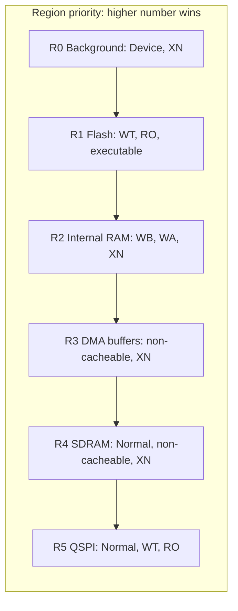

```text
Address space (not to scale)

0x0000_0000 +---------------------+  R0 Device + XN (background, covers everything)
            |  ITCM (on-chip)     |
0x0800_0000 +---------------------+  R1 Flash (AXI)  Normal WT, executable
            |                     |
0x2000_0000 +---------------------+  R2 Internal RAM Normal WB-WA, XN
            |   ...               |
0x2007_C000 +---------------------+  R3 16 KB DMA region, non-cacheable (overrides R2)
0x4000_0000 +---------------------+  peripherals (Device, XN from R0)
0x9000_0000 +---------------------+  R5 QSPI (memory mapped)
0xC000_0000 +---------------------+  R4 SDRAM
0xE000_0000 +---------------------+  Private peripheral bus: always Strongly-ordered, not affected by MPU
```

### Default memory attributes without an MPU configuration (ARMv7-M)

Useful because many surprises come from a region you never configured.
| Address range | Region | Default attributes |
|---|---|---|
| 0x0000_0000 to 0x1FFF_FFFF | Code | Normal, write-through |
| 0x2000_0000 to 0x3FFF_FFFF | SRAM | Normal, write-back, write+read allocate |
| 0x4000_0000 to 0x5FFF_FFFF | Peripheral | Device, XN |
| 0x6000_0000 to 0x7FFF_FFFF | External RAM | Normal, write-back, write+read allocate |
| 0x8000_0000 to 0x9FFF_FFFF | External RAM | Normal, write-through |
| 0xA000_0000 to 0xBFFF_FFFF | External device | Device, shareable, XN |
| 0xC000_0000 to 0xDFFF_FFFF | External device | Device, XN |
| 0xE000_0000 to 0xE00F_FFFF | Private peripheral bus | Strongly-ordered, XN |
| 0xE010_0000 to 0xFFFF_FFFF | Vendor system | Device, XN |

What this means on the F769 :

* Internal SRAM is cacheable write-back by default, so DMA buffers in it **are** exposed to the coherency problem from the start.
* The QSPI window falls in the 0x8000_0000 range, which defaults to write-through Normal.
* The SDRAM window at 0xC000_0000 defaults to Device, so it is safe from speculation and not cached until you say otherwise.

---

# Cache Policies

Caching is a technique for keeping a temporary copy of data in fast memory close to the CPU.

* The cache keeps the most recently used words in a small, fast memory, so repeat accesses are quick.
* There are two caches on the Cortex-M7: **Instruction Cache** and **Data Cache**.
* **[STM32F769-specific]** ST's Cortex-M7 parts have 16 KB I-cache and 16 KB D-cach and 32 bytes cache line.
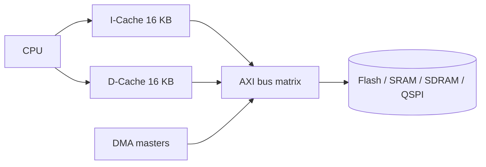

Note the DMA arrow: it joins the bus **after** the caches. That is the whole coherency problem in one picture.

## Cache Hit and Cache Miss

* On a **READ**, a *hit* means the requested data is found in the cache.
* On a **WRITE**, a *hit* means the address to be written is found in the cache.
* Anything else is a *miss*, and the line has to come from (or go to) main memory.

## Dirty Bit

The dirty bit tells you whether the cached copy differs from main memory.

* Each cache line has a dirty bit.
* **Dirty** = modified in the cache, memory is out of date. **Clean** = identical to memory.
* A line is written back to memory only if the dirty bit is set.
* That cuts down on write operations to the memory.

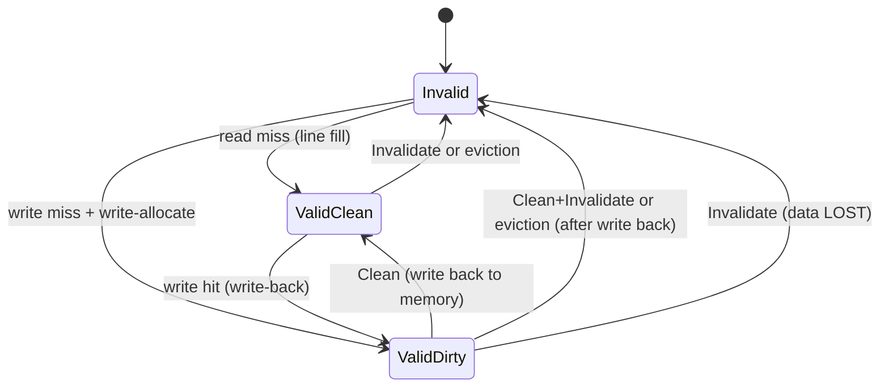

The last transition is the dangerous one. Invalidating a dirty line throws away the CPU's only copy of those writes.

## Cache Policies

Four terms to keep apart:

* Write Through
* Write Back
* Write Allocate
* Read Allocate

### Write Through

* Data is updated in the cache **and** in main memory at the same time.
* Safer for coherency (memory is always current), but needs more bus accesses.
* Every store causes a memory access.
* It suits data that is not written often.

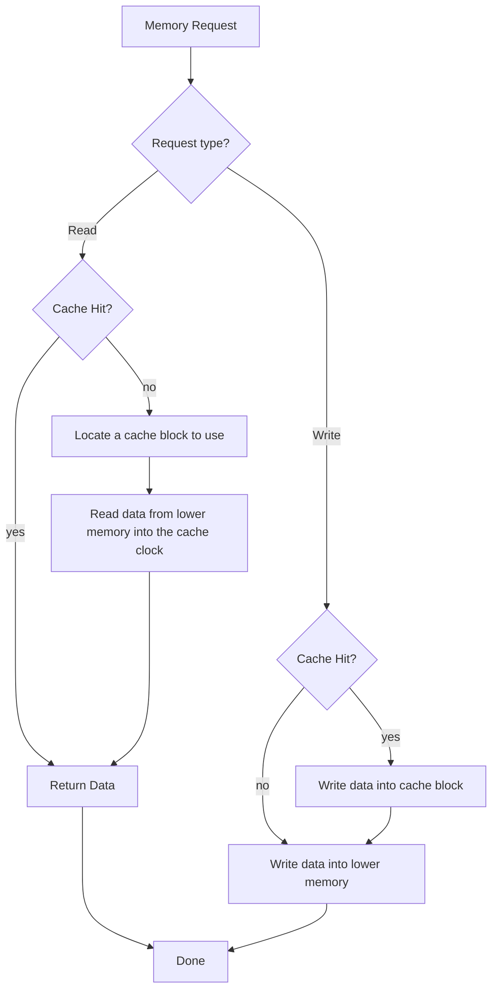

### Write Back

* On a **hit**, the write goes to the cache only and the **dirty bit is set**.
* Main memory is updated later, when the line is evicted (or cleaned by software).
* On a **miss**, what happens depends on whether **write allocate** is enabled.


### Write Allocate

* Applies when there is a cache **miss** during a write-back store.
* The line is loaded from memory into the cache.
* The write is then applied in the cache and the dirty bit is set.
* Write-back is mostly used together with write allocate, because a program that writes a location often tends to write or read nearby locations soon after.

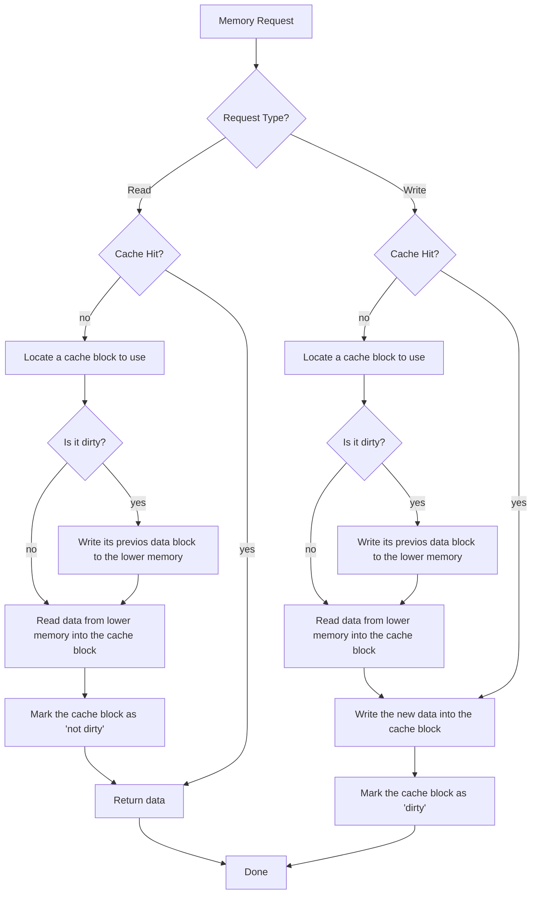


### Read Allocate

* All cacheable locations on Cortex-M7 based MCUs are read allocate.
* On a read miss, a data cache line is allocated and **32 bytes** are brought in from main memory.
* Later accesses to those addresses are cache hits, served directly from the cache.

## STM32 Cache Policies

The app note (Section 2) names the supported configurations like this: **WB-RWA** (write-back, read and write allocate), **WB-NWA** (write-back, read allocate, no write allocate), **WT-NWA** (write-through, read allocate, no write allocate), and non-cacheable. Its comments:

* WB-RWA gives the best performance. Write misses copy the line into the cache, so later accesses hit.
* WB-NWA helps only when data is written but not read back soon, because write misses do not bring the line into the cache.
* WT-NWA performs every write (hit or miss) on main memory, which negates the main advantage of the cache. It only **partially** solves the coherency problem.
* Non-cacheable: every read and write goes to main memory. No coherency issues.

The same three policies as a table (STM32F7 selects them through the MPU attributes):

| Policy | Write hit | Write miss | Read miss | TEX / C / B |
|---|---|---|---|---|
| Write-through, no write allocate | Update cache and main memory | Update main memory only; line not brought into cache | Line allocated | 000 / 1 / 0 |
| Write-back, no write allocate | Update cache, set dirty bit; main memory **not** updated | Update main memory only; line not brought into cache | Line allocated | 000 / 1 / 1 |
| Write-back, write and read allocate | Update cache, set dirty bit; main memory **not** updated | Fetch line into cache, then update it and set dirty bit | Line allocated | 001 / 1 / 1 |

Plus **non-cacheable** (001 / 0 / 0) when you want to bypass the cache entirely.

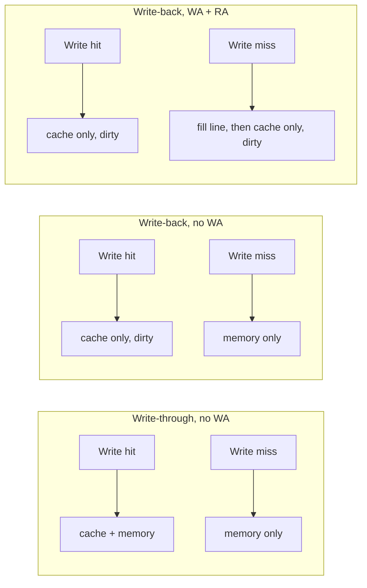

Which one to pick:

* **Write-back + write/read allocate:** best performance, needs maintenance for DMA buffers.
* **Write-through:** slower for writes, but memory is always current. It removes the "CPU wrote, DMA reads stale memory" problem. It does **not** remove the "DMA wrote, CPU reads stale cache" problem.
* **Non-cacheable:** simplest for shared buffers, slowest for CPU access.

## Attributes in Cortex-M7

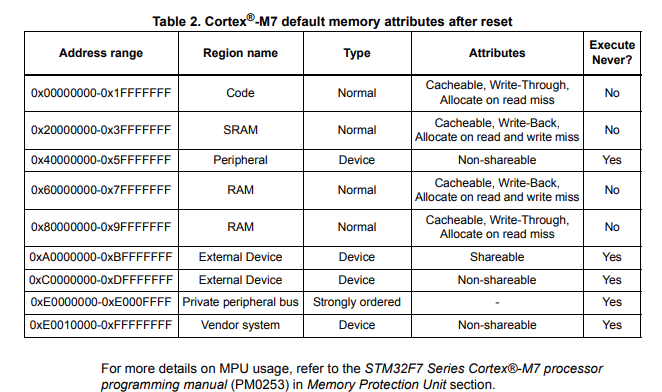


### Cache policy to attribute mapping (summary)

| What you want | Memory type | Cacheable | Bufferable | Shareable | XN | Typical use |
|---|---|---|---|---|---|---|
| Fastest RAM | Normal | WB, WA/RA | yes | no | yes (if data only) | Stacks, heaps, working buffers |
| Memory always current | Normal | WT | no | no | per use | Flash, QSPI, read-mostly data |
| DMA buffer without maintenance | Normal | non-cacheable | no | no (or yes) | yes | DMA buffers |
| Ownership flags shared with a bus master | Device-like | no | yes | yes | yes | Ethernet descriptors |
| Peripheral registers | Device | no | yes | yes | yes | Default for 0x4000_0000 window |
| Unsafe or unused address | Device or Strongly-ordered | no | n/a | yes | yes | Background region |

---

# Cache Coherency Problems and Maintenance Operations

## What "coherent" means here

The CPU sees memory through the D-cache. A DMA controller sees memory directly. Both are looking at "the same" RAM, but nothing keeps the cache copy and the RAM copy equal. When they differ, one master sees outdated data. The Cortex-M7 has no hardware to fix that, so software has to.

|  |  |
|---|---|
| 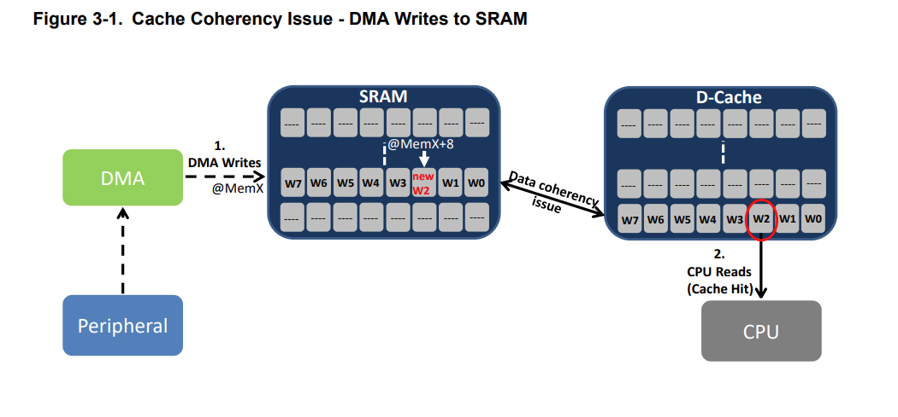 | Cache Coherency Issue: DMA Writes to SRAM |
| 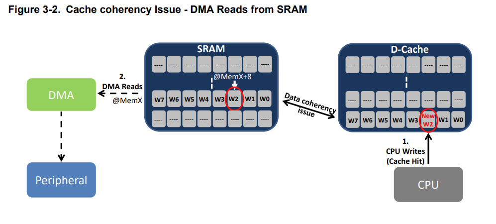 | Cache coherency Issue: DMA Reads from SRAM | 
| 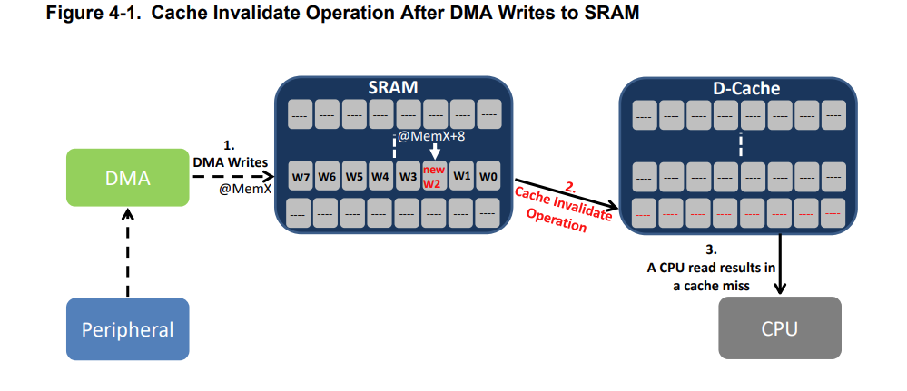 | Cache Invalidate Operation After DMA Writes to SRAM |
| 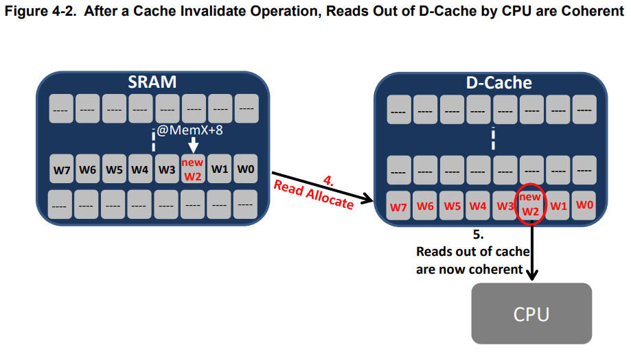 | After a Cache Invalidate Operation, Reads Out of D-Cache by CPU are Coherent |
| 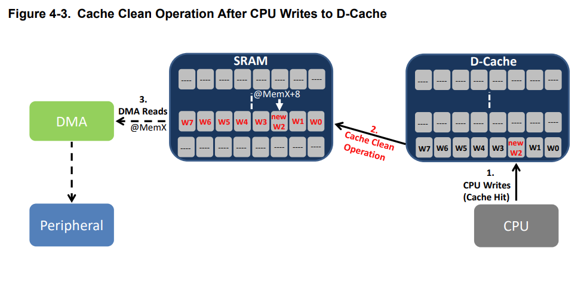 | Cache Clean Operation After CPU Writes to D-Cache | 
| 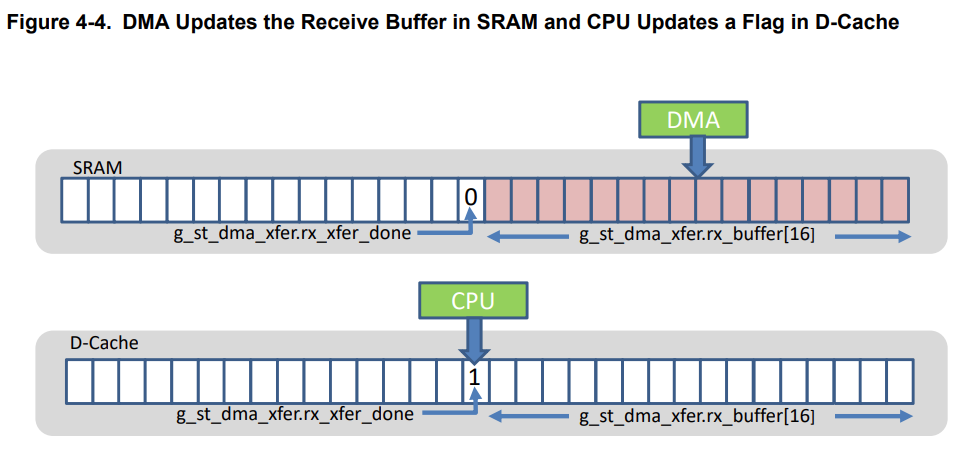 | DMA Updates the Receive Buffer in SRAM and CPU Updates a Flag in D-Cache |
| 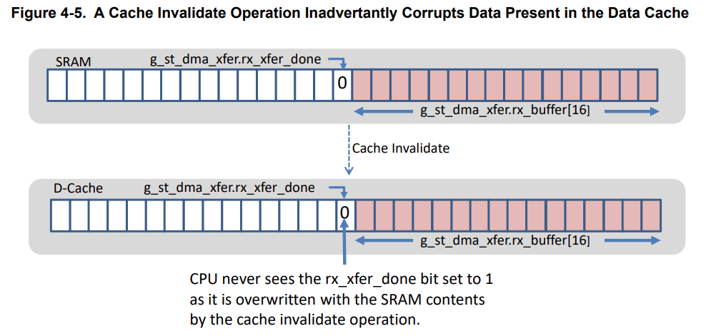 | A Cache Invalidate Operation Inadvertently Corrupts Data Present in the Data Cache |


## The three maintenance operations

| Operation | What it does | Use it when | CMSIS (by address range) |
|---|---|---|---|
| **Clean** | Writes dirty lines back to memory. Lines stay in the cache and become clean. | The CPU wrote data that a DMA will **read** | `SCB_CleanDCache_by_Addr()` |
| **Invalidate** | Marks lines invalid, **discarding** their content. Next read goes to memory. | A DMA wrote data the CPU will **read** | `SCB_InvalidateDCache_by_Addr()` |
| **Clean + Invalidate** | Writes dirty lines back, then drops them. | You need both: buffer is reused in both directions, or you are not sure | `SCB_CleanInvalidateDCache_by_Addr()` |

App note Table 4-1 also lists: `SCB_EnableDCache()` (invalidates the entire data cache before enabling it), `SCB_DisableDCache()` (cleans the data cache to flush dirty data before disabling, according to the app note), and the whole-cache versions `SCB_CleanDCache()`, `SCB_InvalidateDCache()`, `SCB_CleanInvalidateDCache()`. The by-address functions take `(uint32_t *addr, int32_t dsize)`. The app note's rule: **`addr` must be aligned to the cache line size (32 bytes) and `dsize` must be a multiple of 32.** Use the by-address versions for DMA buffers. Whole-cache invalidate is dangerous: it throws away **every** dirty line, including your stack variables.

Memory barriers matter. The CMSIS functions include `__DSB()` and `__ISB()`; if you hand-roll anything, a data barrier between the maintenance operation and the DMA start is required.

## Scenario 1: DMA writes to memory, CPU reads stale cache data

*App note: Figure 3-1 (problem), Figures 4-1 and 4-2 (fix with invalidate).* The app note's fix sequence: DMA writes `rx_buffer[]`; invalidate the cached buffer; the CPU read misses; read allocate refills the line from SRAM; later CPU reads are coherent. In its sample the invalidate is called in the DMA-complete interrupt handler, right after the transfer-done flag is set, and the main loop waits on that flag.

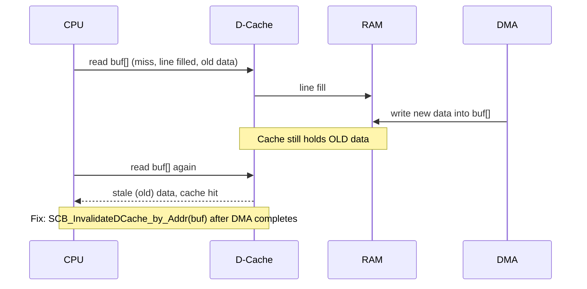

* **Symptom:** received data is wrong, partly old, or "works with the cache off". Often the first bytes look right and the rest do not, or it works the first time and fails after.
* **Cause:** the buffer was in the cache from an earlier access (or a speculative linefill). The DMA updated RAM, not the cache. The CPU hits the old line.
* **Fix:**
  1. Maintenance: after the DMA-complete event, call `SCB_InvalidateDCache_by_Addr()` on the buffer, **before** the CPU reads it.
  2. Or put the buffer in a non-cacheable MPU region.
  3. Write-through does **not** fix this case. It only changes how CPU writes reach memory.

A subtler variant: if the buffer holds **dirty** lines when the DMA starts (the CPU wrote to it earlier), a later eviction can write the old CPU data **over** the DMA's fresh data. So for a receive buffer that the CPU touched earlier, do a **clean** (or clean+invalidate) **before** starting the DMA, and an **invalidate** after it finishes.

## Scenario 2: CPU writes to a write-back cache, DMA reads stale memory

*App note: Figure 3-2 (problem), Figure 4-3 (fix with clean).* The app note's sample copies a string into `tx_buffer`, calls `SCB_CleanDCache_by_Addr()` on it, and only then enables the DMA channel.

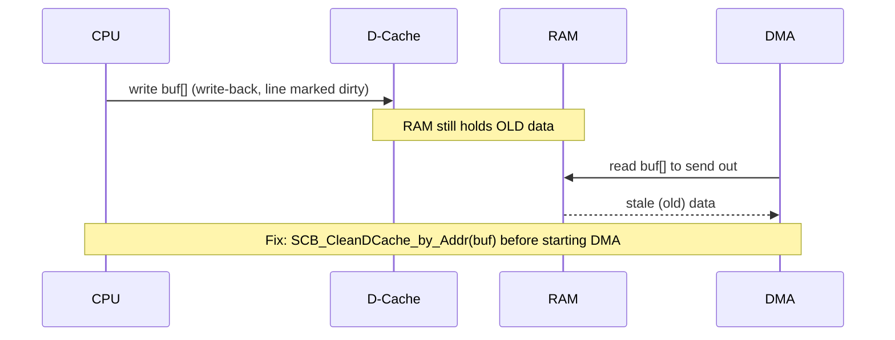

* **Symptom:** the peripheral transmits old or garbage bytes. Changing the buffer content has no effect, or an old message is sent.
* **Cause:** the data is sitting dirty in the cache and has not reached RAM when the DMA starts.
* **Fix:**
  1. Maintenance: `SCB_CleanDCache_by_Addr()` after the CPU finishes writing and **before** starting the DMA.
  2. Or non-cacheable MPU region.
  3. Or a **write-through** region. Writes reach memory straight away, so the DMA sees current data. (Still call `__DSB()` before starting the DMA so buffered writes have completed.)

## Which fix solves which scenario

| Fix | DMA writes, CPU reads (Scenario 1) | CPU writes, DMA reads (Scenario 2) | Cost |
|---|---|---|---|
| Invalidate after DMA | Yes | No | Small, per transfer |
| Clean before DMA | No | Yes | Small, per transfer |
| Non-cacheable region | Yes | Yes | CPU access to buffer is slower |
| Write-through region | **No** | Yes | Every write hits memory |
| Disable D-cache | Yes | Yes | Large performance loss |

## Cache-line alignment (32 bytes) and its pitfalls

Cache operations work on whole 32-byte lines. If your buffer does not start and end on a 32-byte boundary, the first and last lines are shared with neighbouring variables.

```text
Memory:   |<---- line 0 ---->|<---- line 1 ---->|<---- line 2 ---->|
          | var A | buf[0..] |   buf (aligned)  | ..buf end | var B |
                     ^ buffer starts mid-line        ^ buffer ends mid-line
```

**The app note's own example (Figures 4-4 and 4-5).** A struct holds a 16-byte `rx_buffer` (aligned to 32) followed by a `bool rx_xfer_done` flag, so both sit in one 32-byte line.

1. The DMA writes 16 bytes of received data into `rx_buffer` in SRAM.
2. In the DMA interrupt the CPU sets `rx_xfer_done = 1`. The flag was cached earlier, so the write lands only in the D-cache.
3. The ISR then invalidates the buffer's line. That line also holds the flag, so the CPU's `1` is discarded.
4. The next CPU read of the flag refills the whole 32-byte line from SRAM, where the flag is still `0`.
5. The main loop never sees the flag change.

The app note's rule: even if the DMA moves a number of bytes that is not a multiple of 32, the buffer itself must be a multiple of 32 bytes. For a 50-byte transfer the buffer must be 64 bytes.

Pitfalls:

* **Invalidate on an unaligned buffer destroys neighbours.** If `var A` was written by the CPU and is dirty in the same line, invalidating that line discards `var A`'s update.
* **Clean on an unaligned buffer is mostly harmless** (it writes more than needed) but still touches neighbours' lines.
* **DMA writes into the shared line, then CPU writes `var A`** and a later eviction overwrites the DMA's part of the line.
* **Some CMSIS versions round the address and size for you, others do not.** Check your `core_cm7.h`;
* **DMA link descriptors:** the app note says that whenever descriptors are updated by the CPU, clean the cache lines that hold them before the DMA uses them.

Rules:

```c
#define CACHE_LINE 32U
/* Size must be a multiple of 32, start must be 32-byte aligned */
__attribute__((aligned(32))) uint8_t rx_buf[256];
```

* Align DMA buffers to 32 bytes (`__attribute__((aligned(32)))` or the linker).
* Round their size up to a multiple of 32.
* Do not put other variables in the same lines.
* Pass an aligned address and a size that is a multiple of 32 to the maintenance functions.

## Choosing a strategy

| Situation | Suggested approach |
|---|---|
| Few big DMA transfers, CPU touches the data a lot | Cacheable buffer + clean/invalidate |
| Many small transfers, descriptors, flags | Non-cacheable (or Device-like shareable) region |
| Mostly CPU writes, DMA reads | Write-through region, or clean |
| Buffers larger than the cache | Tightly Coupled Memory: not cached, no maintenance, no cache-miss penalty. Needs linker script changes. **[STM32F769-specific: DMA masters can reach DTCM and ITCM before choosing this.]** |
| Unsure why something is flaky | Disable D-cache temporarily to confirm it is a coherency issue |

---

# Quick Reference

* MPU rules: size is a power of two (min 32 B), base aligned to size, higher region number wins.
* Unsafe addresses: **Device or Strongly-ordered + XN**.
* Cache line: **32 bytes**. Align DMA buffers and round sizes.
* DMA wrote, CPU reads: **Invalidate**. CPU wrote, DMA reads: **Clean**. Both: **Clean+Invalidate**.
* Write-through fixes only the CPU-write/DMA-read case.
* Shareable + cacheable normal memory does not use the D-cache on Cortex-M7.
* Whole-cache invalidate destroys dirty data. Avoid it for coherency fixes.
* Configure the MPU **before** enabling caches in start-up code.


## References:

* [Managing Cache Coherency on Cortex-M7 Based MCUs](https://ww1.microchip.com/downloads/en/DeviceDoc/Managing-Cache-Coherency-on-Cortex-M7-Based-MCUs-DS90003195A.pdf)
* [How to Configure the Memory Protection Unit](https://ww1.microchip.com/downloads/en/DeviceDoc/90003179A.pdf)
* [STM32F7 Series system architecture and performance](https://www.st.com/resource/en/application_note/an4667-stm32f7-series-system-architecture-and-performance-stmicroelectronics.pdf)
